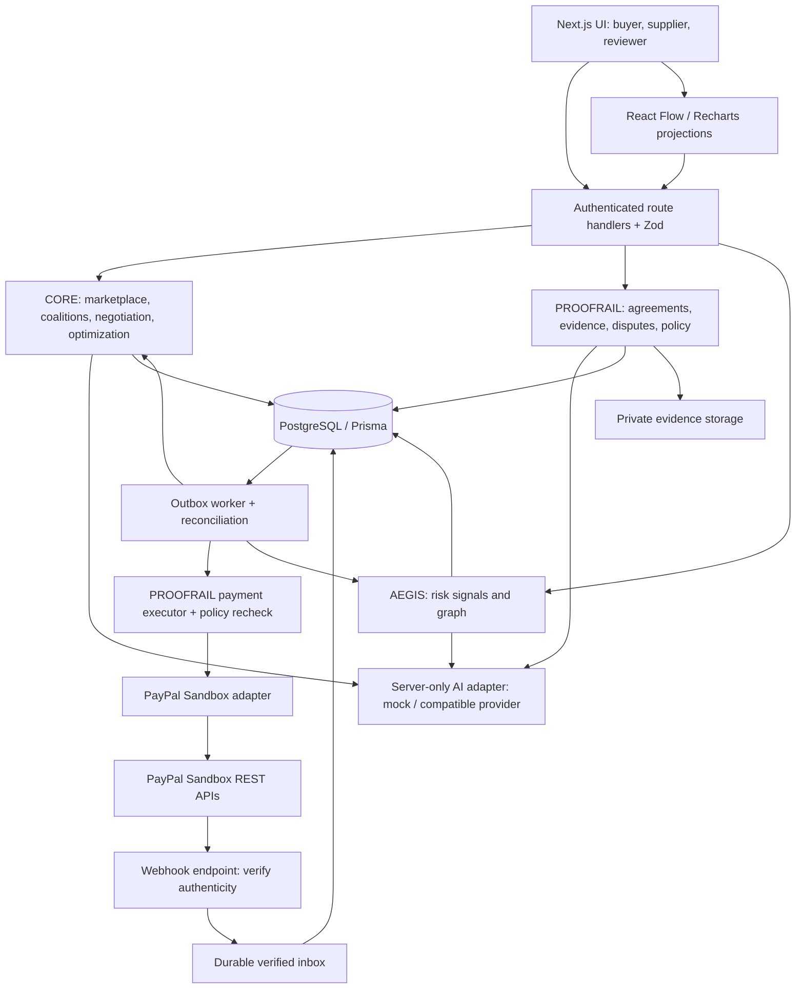
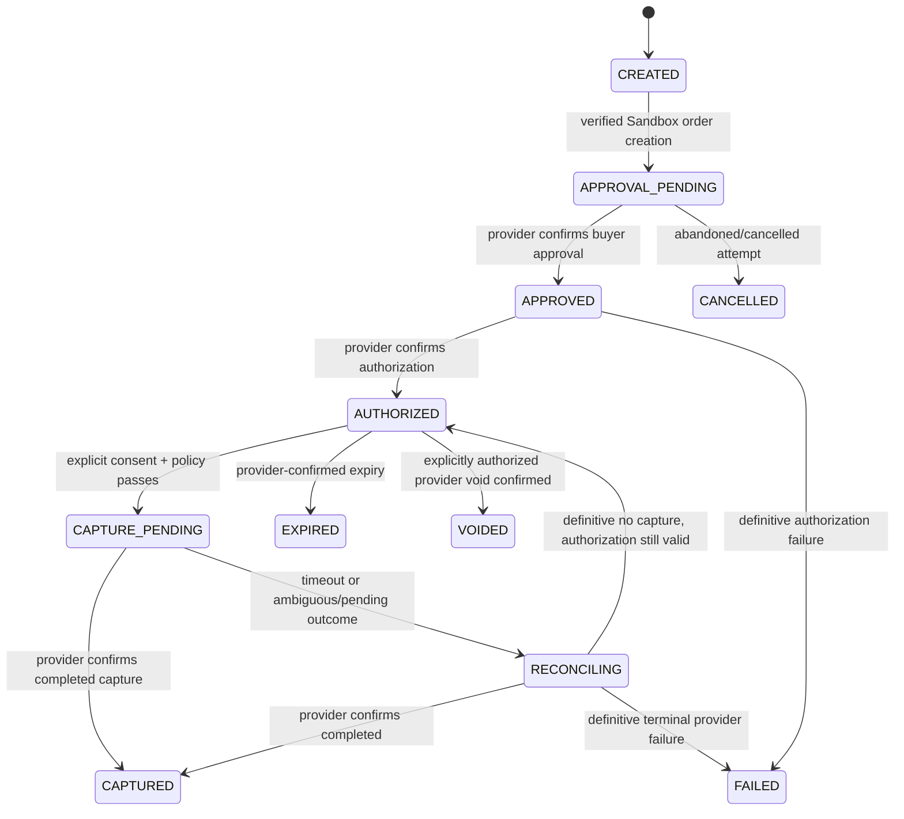

# NEXORA architecture proposal
Status: Phase 1 foundation implemented; later module behavior below remains proposed. The modular-monolith architecture is preserved. No commerce, AI, risk, verification, worker or payment execution is implemented.

## Components and boundaries

Suggested future layout: src/app for UI and routes; src/modules/core, proofrail, aegis for domain/application logic; src/server for auth, configuration, database and providers; src/workers for durable consumers; tests for integration and browser suites. Phase 1 creates src/app, src/components, src/modules/core and src/server; workers and remaining domain modules are deferred.

CORE cannot execute payments. AEGIS cannot grant payment authorization or directly mutate agreements. PROOFRAIL alone evaluates payment eligibility; its executor owns provider side effects. AI may assist evidence extraction, but reviewer decisions and deterministic rules remain authoritative. Read projections may join data through explicit query services; write ownership remains with each module.

## Data model proposal
All mutable aggregates have IDs, timestamps and optimistic version fields. Foreign keys, unique constraints and tenant/resource checks enforce relationships. Store monetary values as PostgreSQL bigint minor units plus currency; expose decimal integer strings in JSON. Quantities are positive integers for initial fixtures; currency conversion and fractional goods are out of scope.

| Owner | Proposed entities and constraints |
| --- | --- |
| Foundation | User, Organization, Membership with roles; AuditRecord with actor, action, target, correlation ID and redacted changes |
| CORE marketplace | Demand: buyer, specification, destination, quantity, budget, currency, deadline, state; SupplierProfile; Offer: supplier, unit/total pricing, capacity, expiry, version |
| CORE coalitions | Coalition, CoalitionMembership with opt-in status and demand version; enforce one active allocation per committed demand quantity |
| CORE negotiation | NegotiationSession, Round, Proposal: participants, versioned offers, limits, expiration, provider provenance; accepted proposal requires explicit participants |
| CORE allocation | AllocationPlan, AllocationLine: buyer, supplier, quantity, cost, baseline, savings, rounding result, objective version; quantities/costs conserve totals |
| PROOFRAIL | Agreement, AgreementVersion, Acceptance: immutable terms hash and participant signature/consent record; Milestone with predefined rubric and due date |
| PROOFRAIL evidence | Evidence: private object key, hash, submitter, timestamp, metadata; EvidenceReview: reviewer, rubric results, reason, version; Dispute: opened/resolved records, holds and resolution authority |
| PROOFRAIL payments | Payment: buyer allocation, payee, agreement version, amount/currency, mode, provider IDs; PaymentConsent: exact action scope, expiry and usage; PolicyDecision: input versions, rules version, reasons |
| Payment reliability | PaymentOperation: unique logical action key, immutable request hash, provider request ID, operation state, lease, attempts; WebhookInbox: unique provider/event ID; ReconciliationJob |
| AEGIS | RiskSignal: source, evidence reference, confidence, time; RiskAssessment: subject, model/rule version, score, reasons, missing data; GraphEdge projection with provenance |
| Infrastructure | OutboxEvent with aggregate/version and dispatch state; ConsumerReceipt with unique consumer/event; SimulationRun with seed, scenario version and mode |

Payment relationships bind one buyer and one configured demo merchant. Coalition acceptance does not authorize a coordinator to charge other members. Fair savings default proposal: compare each buyer's committed cost against a disclosed comparable standalone quote; allocate shared discounts proportionally to baseline spend using largest-remainder rounding with stable tie breaking. Do not fabricate a baseline when absent; mark savings unavailable. Objective weights, baseline freshness, negative-savings treatment, fees/tax/shipping inclusion and minimum benefit constraints must be decided in Phase 3.

## API contracts (proposed /api/v1)
Every mutating endpoint validates a Zod schema, session, role, resource ownership, expected aggregate version and request limits. Responses include requestId and mode where relevant. Amount example: { "amountMinor": "12500", "currency": "USD" }. Timestamps are UTC ISO-8601. Collection endpoints use bounded cursor pagination.

| Endpoint | Request / result and authority |
| --- | --- |
| POST /demands; GET /demands | Buyer supplies specification, quantity, maxTotalMinor, currency, destination and deadline; returns owned demand |
| POST /offers; GET /offers | Supplier submits versioned capacity, prices and expiry; public projections omit private terms |
| POST /coalitions; POST /coalitions/:id/memberships | Coordinator requests compatibility proposal; each buyer opts in to its demand version |
| POST /coalitions/:id/optimization-runs | Returns 202 with runId; worker returns feasible allocation, reasons and objective breakdown |
| POST /negotiations; POST /negotiations/:id/proposals | Authorized participant starts bounded session or proposes terms; returns persisted version |
| POST /agreements; POST /agreements/:id/acceptances | Creates draft from validated allocation; participant accepts exact version/hash |
| POST /agreements/:id/evidence | Supplier submits validated private upload reference; returns evidence ID/hash, never a public storage URL |
| POST /evidence/:id/reviews | Designated reviewer records rubric result and reason; AI output cannot call this endpoint |
| POST /agreements/:id/disputes | Participant opens hold; separate reviewer resolution command records reason and authorization |
| GET /risk-assessments/:id; GET /relationships | Authorized scope only; returns advisory signals, confidence, provenance |
| POST /payments | Buyer requests an exact accepted allocation; creates idempotent Sandbox order and returns approval URL plus paymentId |
| POST /payments/:id/authorize | After buyer checkout approval, server verifies provider order/amount/payee and requests authorization; browser assertions are insufficient |
| POST /payments/:id/consents | Buyer explicitly consents to exact capture action and bound terms; no provider side effect |
| POST /payments/:id/capture | Requires Idempotency-Key and valid consent; returns 202 operationId and policy decision, or deterministic rejection |
| GET /payment-operations/:id | Returns persisted processing/unknown/confirmed/failed outcome; never infers success from redirect |
| POST /webhooks/paypal | No user session; authenticity verification, payload limits, durable deduplication and asynchronous processing |
| POST /simulations; GET /simulations/:id | Operator runs seeded isolated fixtures; simulated payments cannot reach Sandbox adapter |

Other mutations also accept client idempotency keys where retried requests could duplicate resources. Equal key plus unequal payload returns 409. All provider mutation operations use durable internal keys even when initiated by a webhook or worker.
Error envelope: { error: { code, message, retryable, details }, requestId }. Use 400 invalid input, 401 unauthenticated, 403 forbidden, 404 unavailable resource, 409 version/idempotency conflict, 422 policy or feasibility rejection, 429 throttling, 503 dependency unavailable. Do not leak resource existence across tenants. A timed-out payment call returns an operation in UNKNOWN/RECONCILING, not a definitive failure or success.

## Event-driven workflows
Versioned envelope: eventId, type, schemaVersion, aggregateId, aggregateVersion, occurredAt, correlationId, causationId, mode, minimal payload. Domain changes and outbox insert share a PostgreSQL transaction. Worker claims records with leases; delivery is at least once, with retry backoff and dead-letter inspection. Consumer receipt plus domain change commit atomically. No broker is required initially.

1. DemandSubmitted / OfferPublished -> compatibility projection -> CoalitionProposed; membership requires buyer action.
2. CoalitionCommitted -> OptimizationRequested -> AllocationProposed -> NegotiationStarted -> ProposalValidated; accepted terms produce AgreementVersionAccepted.
3. EvidenceSubmitted -> advisory extraction + reviewer queue -> EvidenceReviewed. DisputeOpened immediately creates a payment hold.
4. CaptureRequested -> durable operation -> fresh policy evaluation -> provider call -> CaptureObserved / PaymentReconciliationRequired.
5. Verified webhook -> durable inbox -> resource/amount/payee/mode checks -> payment reconciliation -> PaymentStatusChanged -> analytics projection.

Events schedule work, not permission. Risk changes can add holds through deterministic rules; clearing a hold requires authorized policy/review. Out-of-order events never regress a confirmed provider state; conflicting observations trigger provider retrieval. Critical capture preconditions are read from authoritative state, not lagging projections.

## Payment state machine
Local payment state, individual operation state, consent state, and agreement/evidence state are separate. PayPal order approval is distinct from application capture consent.

Order creation and authorization calls can also be uncertain: retain their last confirmed payment state and mark the corresponding operation UNKNOWN until reconciled. Provider pending capture is not CAPTURED. Expired/cancelled/failed attempts never silently restart; a replacement attempt requires valid new approval and consent. Refunds are a later explicit workflow, not an implicit consequence of an internal dispute; the initial demo excludes refunds, partial capture and multiple milestone captures.

Capture gate: authenticated buyer consent bound to payment/action/amount/currency/payee/agreement hash, unexpired and unused; participant acceptances; reviewer-accepted required evidence; no dispute/risk hold; matching valid Sandbox authorization; sufficient uncaptured amount. Record rules/input versions and reason codes.

Serialize capture, dispute, hold, and agreement mutations through the same payment/aggregate lock. In a short transaction, validate and reserve the operation/consent, then call PayPal outside the database transaction. Recheck queued work immediately before dispatch. After dispatch, a newly opened dispute cannot undo an external call: record its ordering and route for review; never claim cross-system atomicity. Retry only the identical persisted request ID/payload when safe; uncertain results remain reserved until reconciliation. One active capture operation per payment prevents concurrent requests with different keys from double charging.

PayPal authorization windows are constrained: [official authorize/capture guidance](https://developer.paypal.com/checkout/delay-capture/) recommends the initial three-day honor period within the 29-day authorization period. Never model an indefinite hold or guarantee capture. [Idempotency guidance](https://developer.paypal.com/api/rest/requests/) is endpoint-specific. [Webhook verification](https://developer.paypal.com/api/rest/webhooks/rest/) must precede inbox acceptance; verification outage must cause retryable failure, not acceptance. Return success only after durable inbox storage; processing may continue asynchronously. Preserve verification data privately with bounded retention.

## AI provider abstraction
An internal provider interface exposes proposeNegotiation(context, limits), summarizeEvidence(input), and explainRisk(signals). Adapters map to compatible chat APIs or deterministic mocks; compatibility is verified rather than assumed. Zod validates outputs against versioned proposal schemas. Domain services enforce business constraints independently.
Record provider/model identifiers, prompt/schema versions, request correlation, duration, token/cost budget and output validation status. Bound timeouts, retries and rounds. Missing credentials, malformed output, injection, or provider failure yields explicit unavailable/manual-review status. No model receives database credentials, payment tools, unrestricted network access, or authority to accept terms.

## Errors, observability and operations
Use typed domain errors and stable reason codes; keep internal/provider diagnostics separate from safe client messages. Retry transient failures with jitter and limits; never retry validation/policy rejection. Reconcile unknown payment outcomes before resubmission.
Structured logs carry request, event, agreement and operation IDs plus mode. Redact credentials and personal evidence. Metrics include queue age, dead letters, model validation failures, policy rejects, webhook verification failures, ambiguous payments and reconciliation lag. Audit agreement acceptances, reviewer actions, consent, policy inputs and provider observations with restricted append-only application access; this alone is not cryptographic tamper proofing.
Provide correlation across routes/workers/provider calls, dependency health, backup/restore procedures, migration checks and reconciliation alerts in later phases. React Flow is a visualization of stored relationships, not the source of risk facts.

## Open design decisions
Authentication and organization model; reviewer authority and conflicts of interest; evidence rubric/storage/retention; solver versus heuristic and weights; fairness policy; risk thresholds and appeals; deployment and worker scheduler; PayPal merchant permissions and any future marketplace product. Validate these through the roadmap gates rather than claiming them implemented.
## Phase 1 implementation decisions and limits
- Better Auth 1.7.22 uses the Prisma PostgreSQL adapter, email/password credentials and database sessions. Public registration is disabled. A trusted local operator provisions accounts and organization-scoped memberships. Each protected operation rechecks active persisted membership; ORG_ADMIN is not a payment or buyer/supplier super-role.
- Next.js 16.4.6 / React 19.3.1, TypeScript strict mode, Tailwind 4, Prisma 7.10.1 with the pg adapter, Zod, Vitest, Playwright, Lucide and Recharts form the foundation. Stable Prisma 7 was selected because the npm latest tag pointed at a Prisma 8 release candidate during implementation; Better Auth declares compatibility with Prisma 7. No sponsor SDK or React Flow dependency is needed in this phase.
- Public demo routes render static shared fixtures, including illustrative chart observations, regardless of operational mode. Authenticated /workspace routes and /api/v1/organizations/:organizationId access real membership data. Never mix these data sources silently. API contracts earlier in this document remain proposed except for auth, health and organization read routes.
- The foundational schema includes all requested Phase 1 entities plus Better Auth Account/Session/Verification/RateLimit. Composite foreign keys scope related commerce records to one organization; SQL CHECK constraints enforce positive monetary/quantity values, USD initial scope, bounded rounds, evidence shape and simulation/provider-ID isolation.
- AgreementVersion/Acceptance, allocation results, payment consent/operation/policy records, risk assessments, outbox/inbox/consumer receipts and immutable agreement enforcement are deliberately deferred to their planned engine phases. No writable domain endpoints exist that would bypass those future controls. Phase 1 Payment is a record shape, not an executable payment service.
- Private evidence storage/scanning and durable workers are unimplemented. No evidence is seeded and no verified fulfillment is claimed. A demo agreement can have a synthetic ACTIVE status without binding terms; the organization and UI explicitly identify it as demonstration data.
- No architecture replacement was necessary. Deployment remains undecided; Render is a candidate documented in docs/SPONSOR_STRATEGY.md. Local PostgreSQL execution and real sign-in verification remain blocked until PostgreSQL is available; see docs/PHASE1_VERIFICATION.md.
